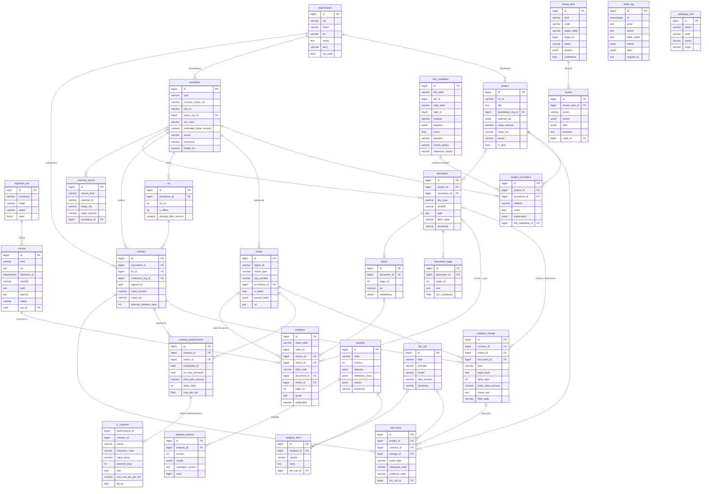

# ex ante (Risk Miner): dokumentacja techniczna

HackNation 2026, wyzwanie MFiPR „Risk Miner”. Baza przypadków ze źródłami i analityka ryzyka dla publicznych
inwestycji wodociągowo-kanalizacyjnych (wod-kan), zasięg krajowy, z drugim sektorem (drogi) jako rozszerzeniem.

Dokument odpowiada na wymagania z treści zadania: §6 „Dokumentacja techniczna” (schemat architektury i modelu
danych, źródła i metody dopasowania, instrukcja uruchomienia, modele, usługi, biblioteki i licencje) oraz §5
(konfiguracja z własnym kluczem, miejsce przetwarzania danych, licencje). Liczby z bazy pochodzą z zapytań tylko do
odczytu wykonanych 2026-11-21 na lokalnej bazie demonstracyjnej (Postgres 18, `riskminer-db`).

Spis treści:
1. Architektura
2. Model danych i niezmienniki pochodzenia
3. Źródła danych
4. Metody dopasowania (łączenia)
5. Analityka i AI
6. Gdzie przetwarzane są dane
7. Uruchomienie i konfiguracja z własnym kluczem
8. Modele, usługi, biblioteki i licencje
9. Bezpieczeństwo i ślad audytowy

---

## 1. Architektura

```mermaid
flowchart LR
  subgraph SRC["Źródła publiczne i pliki"]
    XLSX["Zestaw organizatora XLSX (22 projekty)"]
    BZPC["Kopia BZP organizatora (JSONL)"]
    BZPA["BZP / e-Zamówienia API (delta na żywo)"]
    TED["TED (UE)"]
    KIO["KIO orzeczenia"]
    NIK["NIK wyniki kontroli"]
    CRU["Centralny Rejestr Umów"]
    MD["Mapa Dotacji (KPO B3.1.1)"]
    KPOSK["KPOŚK, NFOŚiGW, FE (dane.gov.pl)"]
    GUS["GUS BDL, BIR, wskaźnik cen; Biała lista VAT; KRS"]
    GEO["TERYT, PRG GUGiK"]
    DOCS["Dokumenty postępowań (platformy, BIP)"]
    UP["Uploady użytkownika (DOCX, PDF, XLSX, CSV, skany)"]
  end

  subgraph CON["riskminer/connectors/*"]
    C1["fetch: limit req/s, backoff, robots.txt, stały UA"]
    RAW[("data/raw/&lt;source&gt;/ bajty bez zmian + manifest.jsonl")]
    C2["parse(): rekordy bez dostępu do bazy"]
  end

  subgraph ING["riskminer/ingest/*"]
    L["load: source + rekordy"]
    D["derive: postępowania, części, umowy, zmiany, wykonanie, zdarzenia"]
    K["link: link_pilot, link_national, external"]
    OCR["doctext / OCR (pdftotext, Tesseract)"]
  end

  DB[("PostgreSQL 18 + pgvector, pg_trgm, unaccent")]

  subgraph AN["riskminer/analytics/*"]
    CB["CaseBase w pamięci per sektor"]
    FC["klasa referencyjna, prognozy, podobieństwo, Monte Carlo, backtest"]
  end

  subgraph LLM["riskminer/llm/*"]
    GW["gateway: routing wg wrażliwości, budżet, log llm_call"]
    VF["verify.py: weryfikacja cytatów i liczb"]
  end

  API["FastAPI riskminer/api/* (odczyt + akcje przeglądu)"]
  WK["worker riskminer/jobs/worker.py (kolejka job, SKIP LOCKED)"]
  FE["Frontend React (Vite, TanStack Router/Query)"]

  SRC --> C1 --> RAW --> C2 --> L --> D --> K --> DB
  RAW --> OCR --> DB
  DB --> CB --> FC --> API
  DB <--> GW
  GW --> VF --> DB
  API <--> DB
  WK <--> DB
  WK --> C1
  WK --> GW
  API --> FE
```



### 1.1 Granice modułów (niezmiennik projektu nr 8)

| Moduł | Odpowiedzialność | Czego nie robi |
|---|---|---|
| `backend/riskminer/connectors/*` (22 konektory sieciowe + moduł `platforms.py` dla platform zakupowych; lista: `riskminer sources`) | pobiera, zapisuje surowe bajty i linię manifestu, `parse()` zwraca rekordy Pydantic (`connectors/records.py`: `ExternalRecord`, `SourceCheck`, `DocumentRecord`, `LinkHint`) | nie pisze do bazy |
| `backend/riskminer/ingest/*` | ładuje manifesty do `source`, normalizuje, wyprowadza tabele, łączy rekordy (`linking.py`, `link_national.py`, `external.py`), tworzy `review_item` dla rozbieżności | nie pobiera z sieci |
| `backend/riskminer/api/*` | odczyt, eksport, akcje przeglądu eksperta (`review/service.py`) | nie liczy analityki ani nie woła modeli bezpośrednio |
| `backend/riskminer/analytics/*` | czyste funkcje nad `CaseBase` w pamięci, bez zapisów | nie używa LLM; wszystkie zdania po polsku z szablonów (`analytics/templates.py`) |
| `backend/riskminer/llm/*` | jedna bramka (`gateway.py`), backendy `google_genai`, `openai_compatible`, `replay`, zadania w `llm/tasks/` | nie zapisuje niczego jako zatwierdzone |
| `catalogue/<sektor>/*.yaml` | pakiet sektorowy: podsektory, mapa CPV, ryzyka, leksykon, wagi podobieństwa, klauzule, listy kontrolne | nowy sektor to dane, nie kod |

Pozostałe pakiety: `documents/` (upload, konwersja DOCX do PDF przez LibreOffice, potok dokumentu), `imports/`
(agent importu: deklaratywne specyfikacje importerów, nigdy generowany kod), `review/` (kolejka przeglądu, cofanie),
`monitoring/` (sygnały i alerty), `analysis/` (analiza nowej inwestycji, Red Pen, pakiet do akt), `parsing/`
(parser formularzy BZP, klasyfikator wod-kan).

### 1.2 Topologia wdrożenia (`docs/DEPLOY.md`, `infra/docker-compose.prod.yml`)

```
przeglądarka -> Traefik (TLS, Coolify) -> web (Caddy: build Vite + proxy /api) -> api:8000 -> db:5432
                                                                         worker -> db
```

Usługi: `db` (`pgvector/pgvector:pg18`), `migrate` (`alembic upgrade heads`, jednorazowo), `api` (uvicorn),
`worker` (`riskminer worker`), `web` (Caddy z plikami statycznymi frontendu). Publiczny jest tylko `web`;
`db`, `api` i `worker` nie publikują portów. Obraz backendu: `infra/Dockerfile.backend` (Python 3.12, uv,
poppler-utils, LibreOffice Writer, Tesseract z modelem `pol`).

---

## 2. Model danych i niezmienniki pochodzenia

Schemat: `backend/riskminer/db/models.py` (SQLAlchemy 2) i migracje `backend/alembic/versions/0001`–`0014`
(od `0007` surowy SQL). Diagram pokazuje tabele rdzeniowe i ich klucze obce (kolumny wybrane; tabele z mixinem
pochodzenia mają dodatkowo `source_id`, `origin`, `review_status`, `created_at`, `updated_at`).



Struktura wymagana w §5 zadania jest odwzorowana wprost: **projekt** (`project`) obejmuje wiele **postępowań**
(`project_procedure`, `procedure`); postępowanie ma wiele **ogłoszeń** (`notice`, wersje z `is_latest`,
`superseded_by_id`), **części** (`lot`), **ofert** (`offer`) i **kontraktów** (`contract`); kontrakt ma **zmiany**
(`contract_change`) i **wykonanie** (`contract_performance`); **zdarzenia** wpływające na realizację to
`risk_event` (i sygnały z dokumentów `risk_signal`); **koszty i terminy** są kolumnami kwot i dat w umowach,
zmianach i wykonaniu oraz w widoku `rc_contract`; **dokumenty i źródła** to `document`, `document_page`, `chunk`,
`source`, `evidence`. Rekordy z innych baz (TED, KIO, NIK, CRU, Mapa Dotacji, KPOŚK, GUS…) trafiają do
`external_record` z wynikiem wyszukiwania w `source_check` („szukano, nie znaleziono” jest zapisywane jawnie).

Tabele pomocnicze: `catalogue_risk`, `catalogue_subsector`, `catalogue_cpv_map`, `catalogue_doc_type`,
`catalogue_checklist`, `catalogue_clause`, `catalogue_entry`, `catalogue_version` (pakiet sektorowy w bazie,
edytowalny przez eksperta), `gold_example` (pętla uczenia), `question` (zapisane pytania Q-2026-NNNN),
`change_cause_ai` (klasyfikacja przyczyn zmian przez AI), `model_eval`, `import_session`, `importer`,
`monitor_watch`, `alert`, `job`, `fetch_queue`, `ref_teryt`, `ref_geo_centroid`, `record_counter` (kody bez luk
AN-2026-0001). Widoki: `rc_contract` (zmaterializowany: klasa referencyjna z flagami jakości `dq_flags`, `dq_ok`,
kosztem jednostkowym na km), `v_change_cause_ai`, `v_contract_cause_ai`, `v_monitor_signal`, `v_ask_contract`,
`v_ask_change`, `v_ask_signal`, `v_ask_procedure` (jedyne widoki dostępne dla NL→SQL).

### 2.1 Niezmienniki pochodzenia (egzekwowane w kodzie i w bazie)

| Niezmiennik | Implementacja |
|---|---|
| Każdy rekord faktu ma źródło | `source_id` → `source` (url, `retrieved_at`, `sha256`, `path`, `licence`, `manifest_key`, `run_id`). Jedna linia `data/raw/<source>/manifest.jsonl` = jeden wiersz `source`. Surowe bajty nie są modyfikowane; tabele znormalizowane da się odbudować. |
| Rodzaj pochodzenia | `origin` ∈ `SOURCE`, `CALC`, `AI` (CHECK w bazie, `db/base.py`) |
| Stan przeglądu | `review_status` ∈ `auto`, `proposed`, `approved`, `edited`, `rejected` |
| Dowody | `evidence`: tabela, id i pole twierdzenia, kod pola formularza BZP (`field_code`) albo dokument, strona, zakres znaków i cytat; `verification` ∈ `exact`, `fuzzy`, `unverified`, `structured_field`; `evidence_state` (np. stan NIECZYTELNY przy niskiej pewności OCR) |
| AI nie nadpisuje zatwierdzonych danych | trigger `rm_protect_approved` (migracja 0001) na 15 tabelach faktów, a od 0008 i 0009 także na `change_cause_ai` i `link_candidate`: wiersz `approved`/`edited` może zmienić tylko ścieżka eksperta (`SET LOCAL riskminer.expert_write = 'on'`); potok przy upsercie zachowuje wersję zatwierdzoną, a DELETE zgłasza wyjątek. Wyniki AI są wstawiane jako `origin = AI`, `review_status = proposed`. |
| Dziennik tylko do dopisywania | trigger `audit_log_append_only` blokuje UPDATE i DELETE; decyzje eksperta to wiersze `review` (z `before`, `after`, `undo_of`, `request_id`) |
| Migawki analiz | `analysis_version` z triggerami `analysis_version_immutable` i `analysis_version_nodelete`: wynik analizy z wersją katalogu, datą danych i ziarnem losowania jest odtwarzalny |
| Pieniądze jako obiekt wartości | kolumny `<x>_amount`, `<x>_currency`, `<x>_vat` (`net`, `gross`, `unknown`). Szacunki BZP są netto, wartości umów, ceny i płatności brutto; porównania tylko jak z jak (np. CRU o nieznanej podstawie VAT porównywane z ×/÷ 1,23) |
| Rozbieżności nie są poprawiane po cichu | każda niezgodność między zbiorami trafia do `review_item` (np. `nip_mismatch`, `part_mismatch`, `value_deviation`, `contract_notice_missing`, `change_count_mismatch`) |

### 2.2 Liczności (baza demonstracyjna, 2026-11-21, `count(*)`)

| Tabela | Wiersze | Tabela | Wiersze |
|---|---:|---|---:|
| `project` | 22 | `evidence` | 860 286 |
| `project_procedure` | 22 | `source` | 47 250 |
| `procedure` | 101 016 (wod-kan 45 347, drogi 55 669) | `document` | 11 062 |
| `notice` | 248 642 | `document_page` | 66 045 |
| `lot` | 112 733 | `chunk` | 214 451 |
| `contract` | 128 051 | `external_record` | 354 796 |
| `contract_change` | 60 293 | `organization` | 18 641 |
| `contract_performance` | 68 755 | `link_candidate` | 3 589 |
| `risk_event` | 126 231 (CALC/auto 126 134, AI/proposed 97) | `review_item` | 147 (otwarte) |
| `rc_contract` | 67 562 | `review` | 2 |
| `change_cause_ai` | 20 694 (AI/proposed) | `audit_log` | 97 |
| `analysis` / `analysis_item` / `analysis_version` | 8 / 266 / 7 | `llm_call` | 1 003 |

Dowody: 860 189 to pola formularzy BZP (`structured_field`), 95 cytaty dokładne, 2 przybliżone. Kolumna
`chunk.embedding vector(1024)` (BAAI/bge-m3) jest przygotowana, ale nie jest wypełniona (0 wierszy); wyszukiwanie
i część tekstowa podobieństwa działają na pełnotekstowym `tsvector` i BM25. Wersja schematu: dwie głowice Alembic,
`0009_review` i `0014_bzp_changes_only`.

---

## 3. Źródła danych

Zasady pobierania (`docs/scrape.md` §0, `connectors/base.py`):

- ≤ 1 żądanie/s na host (produkcyjne API e-Zamówień ≤ 25/min, `min_interval_s: 2.5`), wykładniczy backoff na 429
  i 5xx (tenacity), respektowanie `robots.txt` i `Crawl-delay`;
- stały User-Agent bez danych osobowych: `RiskMiner-hackathon/0.1 (research prototype; HackNation 2026)`;
- bez obchodzenia CAPTCHA i WAF: strona wyzwania jest zapisywana jako `blocked` (np. eksport CSV Mapy Dotacji za
  reCAPTCHA, część szczegółów CRU, część odpisów KRS);
- wyjątek od `robots.txt` (decyzja zespołu z 21.11.2026): tylko dla `platformazakupowa.pl` i `logintrade.net`,
  pobieranie publicznych linków do załączników co 5 s, każda linia manifestu z notatką `robots.txt override`
  (konfiguracja `robots_override` w `connectors/base.py`); zgodnie z `docs/test_report_sources.md` za zgodą
  operatorów zgłoszoną przez zespół `[do sprawdzenia: potwierdzenie zgody operatorów]`;
- RODO: osoby kontaktowe, telefony i e-maile zostają tylko w surowych plikach, nie trafiają do tabel
  znormalizowanych, UI ani eksportów (BK2021: osoby kontaktowe usuwane; KIO pseudonimizuje osoby fizyczne);
- każdy konektor przyjmuje `--since/--until/--limit/--only` i pomija świeże wpisy manifestu, więc można go
  uruchomić ponownie bez ręcznych kroków: `uv run riskminer scrape <source>` (lista: `uv run riskminer sources`),
  potem `uv run riskminer load-all` lub zadanie w workerze.

Liczby z `exports/sources_summary.csv` i `docs/test_report_sources.md` (generowane przez `uv run riskminer report`).

| # | Źródło (`id`) | Co bierzemy | Dostęp | Licencja / warunki | Zapytania OK | Rekordy |
|---:|---|---|---|---|---:|---:|
| 1 | Zestaw organizatora (`xlsx`) | 22 projekty pilotażowe | plik XLSX, `riskminer import-xlsx` | dane organizatora | 1 | 22 |
| 2 | Kopia BZP organizatora (`bzp_copy`) | ogłoszenia 4 typów, krajowo | plik JSONL, `riskminer import-bzp-copy` | informacja publiczna | 1 | 113 278 |
| 3 | BZP / e-Zamówienia API (`bzp_api`) | delta od 2026-11-12 + `NoticeUpdateNotice`, CPV wod-kan | REST `ezamowienia.gov.pl/mo-board/api/v1/notice` | informacja publiczna | 384 / 443 | 1 077 |
| 4 | BZP drogi (`bzp_roads`) | CPV 45233*, 2024–2026, drugi sektor | to samo API | informacja publiczna | 418 | 134 287 |
| 5 | TED (`ted`) | ogłoszenia zamawiających z PL, CPV wod-kan, modyfikacje; sprawdzenie 20 NIP | REST `api.ted.europa.eu/v3` + XML | ponowne wykorzystanie UE (Decyzja 2011/833/UE) | 7 380 | 18 325 |
| 6 | KIO (`kio`) | orzeczenia: per zamawiający i korpus krajowy | HTML + PDF `orzeczenia.uzp.gov.pl` | publiczne, osoby fizyczne pseudonimizowane | 6 608 | 2 084 |
| 7 | NIK (`nik`) | wyniki kontroli wod-kan, PDF informacji i wystąpień | HTML + PDF `nik.gov.pl` | informacja publiczna | 1 135 / 1 140 | 80 kontroli (522 pliki) |
| 8 | Centralny Rejestr Umów (`cru`) | umowy wod-kan od 2026-07-01, zmiany i aneksy | wewnętrzne API JSON `rejestrumow.gov.pl` (za WAF) | publiczne (art. 34a u.f.p.) | 4 880 (4 blocked) | 16 982 |
| 9 | Mapa Dotacji (`mapa_dotacji`) | 631 projektów KPO B3.1.1 | HTML (lista + szczegóły; CSV za reCAPTCHA pominięty) | publiczne, z atrybucją | 695 | 631 |
| 10 | KPOŚK (`kposk`) | aglomeracje i oczyszczalnie 2020–2024 | API `dane.gov.pl` (zbiór 3213) | CC BY 4.0 | 6 | 15 950 |
| 11 | NFOŚiGW (`nfosigw`) | dotacje dla aglomeracji | API `dane.gov.pl` (zbiór 2037) | CC0 | 8 | 126 |
| 12 | Lista projektów FE (`fe_projects`) | FE 2021–2027 i 2014–2020 | pliki XLSX/CSV | publiczne | 2 | 2 350 |
| 13 | GUS BDL (`gus_bdl`) | długość sieci, ludność przyłączona per gmina i rok | REST `bdl.stat.gov.pl/api/v1` | dane otwarte GUS, z atrybucją | 449 / 455 | 289 873 |
| 14 | GUS wskaźnik cen (`gus_price_index`) | wskaźnik cen budowlano-montażowych | pliki `stat.gov.pl` | dane otwarte GUS | 4 | 671 |
| 15 | GUS BIR / REGON (`gus_bir`) | TERYT i dane podmiotu | SOAP, środowisko testowe z publicznym kluczem (adresy zanonimizowane) | rejestr publiczny | 81 | 38 |
| 16 | Biała lista VAT (`vat_whitelist`) | NIP → nazwa, REGON, KRS, status VAT | REST `wl-api.mf.gov.pl` (limit 100/dzień) | rejestr publiczny | 9 | 234 |
| 17 | KRS (`krs`) | odpis aktualny wykonawców (likwidacja, upadłość) | REST `api-krs.ms.gov.pl` | rejestr publiczny | 108 (107 blocked) | 107 |
| 18 | TERYT (`teryt`) | słownik TERC | API słownikowe `aplikacje.gov.pl` / pliki eTERYT | publiczne (GUS) | 399 | 4 360 |
| 19 | Granice PRG (`geo`) | województwa, powiaty, gminy | WFS `mapy.geoportal.gov.pl` (PRG GUGiK) | dane otwarte, bez ograniczeń (art. 40a ust. 2 pkt 1 Pgik), atrybucja „PRG, GUGiK” | 35 | 2 875 |
| 20 | Baza Konkurencyjności (`bk2021`) | sprawdzenie 22 zamawiających | HTML/API `bazakonkurencyjnosci.funduszeeuropejskie.gov.pl` | publiczne, osoby kontaktowe usuwane | 130 | 110 |
| 21 | BIP 22 gmin (`bip_22`) | WPF, zarządzenia, rejestry umów | HTML (robots → sitemap → filtr słów) | informacja publiczna | 1 799 / 1 912 | 78 |
| 22 | Dokumenty 22 postępowań (`docs_22`) | SWZ, PFU/OPZ, umowy, pytania i odpowiedzi, wybór oferty | API e-Zamówień (`mp-readmodels`) + platformy zakupowe | informacja publiczna | 2 649 / 3 077 (417 blocked) | 1 138 dokumentów |
| 23 | Dokumenty, próba krajowa (`docs_sample`) | jw. dla próby warstwowej postępowań | jw. | informacja publiczna | 22 230 / 22 288 | 9 403 dokumenty |

Zbiory celowo pominięte: OpenTender (licencja CC BY-NC-SA), eksport CSV Mapy Dotacji (reCAPTCHA), ogólne
przeszukiwanie BIP i strony RIO (heterogeniczne). Dokumenty: tekst z PDF przez `pdftotext`, DOCX przez
`python-docx`, inne formaty przez LibreOffice; skany OCR Tesseract (`pol`) lokalnie (`riskminer ocr-doc`) lub
wsadowo na WCSS (`scripts/wcss/ocr_batch.py`). Stan po OCR: 3 188 dokumentów, 427 z niską pewnością (oznaczone przy
cytatach), 12 skanów czeka na OCR.

---

## 4. Metody dopasowania (łączenia)

Kolejność metod zgodna z §5 zadania: najpierw identyfikatory, potem dopasowanie rozmyte, zawsze z cechami i
wynikiem zapisanymi w `link_candidate` (`features`, `score`, `rank`, `explanation` po polsku, `decision`).

### 4.1 Normalizacja i walidacja identyfikatorów (`ingest/ids.py`, `riskminer/validators.py`)

| Identyfikator | Normalizacja i walidacja |
|---|---|
| Numer ogłoszenia BZP | `norm_bzp`: akceptuje warianty zapisu, wynik `RRRR/BZP NNNNNNNN` + wersja (`/01`) |
| Numer TED | `ted_valid`: `N-RRRR` |
| OCID | `ocid_valid`: `ocds-148610-…` |
| NIP | `nip_valid`: suma kontrolna (wagi 6,5,7,2,3,4,5,6,7), potem weryfikacja w Białej liście VAT / GUS BIR (`organization.nip_valid`, `verified_by_source_id`) |
| REGON | `regon_valid`: suma kontrolna 9 i 14 cyfr; mapowanie REGON → NIP z pola 1.4 ogłoszeń BZP i z CRU |
| Numer projektu KPO | `kpo_check`: wzorzec `KPOD.03.15-IW.{nn}-{nnnn}/{rr}` i reguła `nn = 12 + TERYT województwa / 2` (zweryfikowana na zbiorze pilotażowym) |
| Nazwy | `fold` (bez diakrytyków, casefold), `norm_org` (usunięta forma prawna), parser nazw gmin z rodzajem jednostki (miejska, wiejska, miejsko-wiejska) |
| Kwoty | `pl_money`: zapis polski (`5 350 782,65 zł`) → Decimal |

### 4.2 Projekty pilotażowe → postępowania BZP (`ingest/linking.py`, etap `link_pilot`)

1. **`exact_id` (wynik 1,0):** numer BZP z zestawu → ogłoszenie o tym numerze; sprawdzenie zgodności NIP i typu
   ogłoszenia (rozbieżność = `review_item`).
2. **`cross_reference` (0,95):** numer nie występuje w źródle, ale późniejsze ogłoszenia tego samego zamawiającego
   go powołują (pole `refs`), np. RM-2026-022 Wolin.
3. **`fuzzy`:** tylko numer KPO: postępowania zamawiającego o danym NIP oceniane na nakładaniu się słów tytułu i
   opisu (Jaccard na rdzeniach 6-znakowych), CPV wod-kan (+0,1) i dacie ≥ 2024 (era KPO B3.1.1, +0,1), skala 0–1;
   próg minimalny 0,21; drugi kandydat w odległości ≤ 0,04 daje `ambiguous_link`.
4. **Łańcuch:** wszystkie ogłoszenia z tym OCID + ogłoszenia zamawiającego powołujące jego numery.
5. **Walidacja krzyżowa → `review_item`:** NIP, województwo, część vs podział na części, wartość projektu vs suma
   umów i wypłat (> 15%), brak ogłoszenia o zamówieniu, liczba zmian.

Wynik na żywej bazie (`project_procedure`):

| `method` | `review_status` | liczba |
|---|---|---:|
| `exact_id` | auto | 14 |
| `fuzzy` | auto | 7 |
| `cross_reference` | auto | 1 |

Względem zestawu referencyjnego (`research/bzp_linking/chains.json`, 22/22 sprawdzone ręcznie; kolumna
`link_candidate.reference_verdict`): 22 poprawne, 0 błędnych. Wykryte rozbieżności w danych organizatora (10
otwartych `review_item` typu `discrepancy`) opisuje `docs/test_report_sources.md` §3.

### 4.3 Łączenie krajowe (`ingest/link_national.py`, etap `link_national`)

**KPO B3.1.1 (Mapa Dotacji) → postępowania BZP, metoda `beneficiary+value+text`.** Mapa Dotacji nie podaje numeru
KPO ani NIP, więc beneficjent jest najpierw rozwiązywany do NIP zamawiającego z BZP: gminy po jednostce TERYT
(nazwa + rodzaj gminy + województwo, np. Gmina Elbląg ≠ Gmina Miasto Elbląg), spółki komunalne po podobnej nazwie
(`rapidfuzz` `token_sort_ratio` / `token_set_ratio` ≥ 0,85) z siedzibą w powiecie z TERYT. Następnie postępowania
wod-kan tego zamawiającego od 2023 r. są oceniane:
`score = (0,45 × tekst + 0,10 × wod-kan + 0,10 × data + 0,35 × wartość) × pewność beneficjenta`, gdzie tekst to
kosinus ważony IDF tytułów i zawieranie tytułu w opisie KPO, a wartość to bliskość kwoty KPO do sumy umów, sumy
wypłat, pojedynczej części lub szacunku × 1,23. Reguły podłogowe: kwota zgodna co do grosza → ≥ 0,97; zgodny tytuł
i kwota w granicach 5% → ≥ 0,92. Zachowywane są 3 najlepsze kandydaty na projekt. 10 par pilotażowych służy
wyłącznie do oceny (nie jest cechą wejściową): precyzja@1 10/10, czułość@3 10/10.

**CRU → umowy BZP, metoda `buyer_id+contractor+value+date`.** Zamawiający po NIP, a gdy go brak po REGON → NIP;
umowy zamawiającego zawarte w oknie ±45 dni, cechy: NIP lub nazwa wykonawcy, wartość (±1%, także ×/÷ 1,23),
odległość dat, wspólne słowa przedmiotu; `combined = 0,40 × wartość + 0,25 × tekst + 0,20 × data + 0,15 × wykonawca`
i progi warstwowe A (≥ 0,90: ten sam wykonawca i kwota), B (0,60–0,89), C (< 0,60).

**Zamawiający → TED, KIO; projekt → Mapa Dotacji** (wskazówki `LinkHint` z konektorów, zapisane przez
`ingest/external.py`): TED `exact_id` (identyfikator zamawiającego = wariant NIP, 1,0) lub `buyer_name+city` (0,6);
KIO `buyer_name+details_zamawiajacy` (0,8, potwierdzone na stronie szczegółów), `buyer_name_ambiguous` (0,4),
`text_mention` (0,2); Mapa Dotacji `exact_value+beneficiary` (1,0, kwota co do grosza + beneficjent).

### 4.4 Progi i decyzje

Progi z `config/config.example.yaml` (`linking:`) i kodu: **akceptacja automatyczna ≥ 0,90** (nadal podlega
przeglądowi), **przegląd 0,60–0,90**, **odrzucenie < 0,60**. Wiersze zatwierdzone, poprawione lub odrzucone przez
eksperta nie są nadpisywane przy ponownym uruchomieniu (`PROTECTED_STATUS` + trigger na `link_candidate`).

| `decision` | `review_status` | liczba |
|---|---|---:|
| accept | auto | 1 324 |
| review | proposed | 1 234 |
| reject | proposed | 1 031 |

| `method` | accept | review | reject |
|---|---:|---:|---:|
| `beneficiary+value+text` (KPO → postępowanie) | 307 | 358 | 982 |
| `buyer_id+contractor+value+date` (CRU → umowa) | 462 | 119 | 20 |
| `exact_id` (zamawiający → TED, projekt → postępowanie) | 537 | 0 | 0 |
| `buyer_name+city` (zamawiający → TED) | 0 | 655 | 0 |
| `buyer_name+details_zamawiajacy` (zamawiający → KIO) | 0 | 66 | 0 |
| `fuzzy` (projekt → postępowanie, kandydaci) | 7 | 36 | 1 |
| `exact_value+beneficiary` (projekt → Mapa Dotacji) | 10 | 0 | 0 |
| `cross_reference` | 1 | 0 | 0 |
| `text_mention`, `buyer_name_ambiguous` (KIO) | 0 | 0 | 28 |

**Niepewne dopasowania trafiają do eksperta.** Kolejka przeglądu (`review_item`, ekran „Przegląd”, obecnie 147
otwartych: 97 zdarzeń AI, 36 powiązań, 10 rozbieżności, 4 propozycje do katalogu) pokazuje pytanie, opcje, wybór
modelu i pewność. Decyzje `approve`, `edit`, `reject` (oraz `skip`, oznaczenie jako przykład wzorcowy `gold`)
zapisują wiersz `review` i `audit_log`; cofnięcie jest możliwe przez 15 minut (`UNDO_MINUTES`) wierszem
kompensującym z `undo_of`, bez usuwania historii. Korekta powiązania przez eksperta (`link_correct`) przyjmuje numer
BZP i części.

---

## 5. Analityka i AI

### 5.1 Silnik analityczny (`backend/riskminer/analytics/`, opis `docs/impl/analytics.md`)

Czyste funkcje nad `CaseBase` ładowanym do pamięci z `rc_contract` (per sektor; wod-kan: `relevance` core/cpv_only,
`scope_kind = works`, około 11,2 tys. wykonanych umów). Każda liczba jest kopertą `Stat` z `origin`, `n` i definicją.

| Element | Metoda |
|---|---|
| Klasa referencyjna (`refclass.py`) | lejek filtrów: wszystkie → podsektor → przedział wartości → formuła (ZiW) → rodzaj robót; progresywne poszerzanie, gdy n < progu (`analytics.min_n_tail: 50`, `min_n_share: 30`, `insufficient_n: 10`) |
| Czas (`forecast.py`) | model ilorazowy `r = rzeczywisty / planowany czas` uzgodniony z deklaracją „w terminie”; jądro długości planu `w = exp(−(ln(rel_j/rel_u))² / 2σ²)`, σ = 0,5, Kish n_eff; ważone kwantyle P10/P50/P80/P90; bootstrap B = 1000 dla przedziałów 90% |
| Udziały (`stats.py`) | opóźnienie, ≥ 1 zmiana, wypłata powyżej wartości: k z n z przedziałem Wilsona 90% (nigdy Wald) |
| Koszt jednostkowy (`unit_cost.py`) | zł/km sieci, klasa = podsektor, długość z tekstu ogłoszenia (`procedure.length_km`), opcjonalna indeksacja wskaźnikiem cen GUS |
| Podobieństwo (`similarity.py`) | `S = Σ w_i s_i / Σ w_i` po cechach obecnych po obu stronach; wagi z `catalogue/<sektor>/similarity.yaml` (np. podsektor 0,20, tekst 0,13, wartość 0,12, długość 0,10, formuła 0,08, technologie 0,07, rodzaj robót 0,07, okres 0,06, region 0,05); część tekstowa BM25 (k1 = 1,2, b = 0,75); wkład każdej cechy `c_i` i luki `g_i` pokazywane w UI |
| Monte Carlo (`montecarlo.py`) | losowanie całych przypadków (N = 20 000, stałe ziarno), nadwyżka czasu i kosztu dzielona po równo między kody przyczyn przypadku, mitygacje z katalogu usuwają część udziału; wiersz „bez rozpoznanej przyczyny” nigdy nie jest usuwany |
| Backtest (`backtest.py`) | uczenie na umowach zakończonych przed 2024-01-01, test na późniejszych: 85% opóźnień w przedziale P10–P90, Brier dla opóźnienia 0,217 (klasa) vs 0,227 (globalnie); znane obciążenie: prawdopodobieństwo opóźnienia zaniżone o ok. 6 pp |
| Flagi (`flags.py`), konkurencja (`competition.py`) | flagi czerwone jako predykaty kodu (CALC, auto); wyniki przetargów z `lot` (unieważnienia, 1 oferta, cena powyżej budżetu) |

### 5.2 Zadania LLM (`backend/riskminer/llm/tasks/`, opis `docs/impl/llm.md`)

| Zadanie | Cel | Alias (public / confidential) |
|---|---|---|
| `extract_features`, `extract_features_text` | cechy nowej inwestycji z opisu, PFU, PPU | strong / sovereign; fast / sovereign |
| `redpen_scan` | sygnały ryzyka na stronach dokumentów przetargowych (Red Pen) | strong / sovereign |
| `classify_causes` | krajowa klasyfikacja przyczyn zmian umów do kodów katalogu | bulk / brak (tylko dane publiczne) |
| `document_facts` | fakty z nowych dokumentów projektu („Co się zmieniło”) | fast / sovereign |
| `chat` | rozmowa o analizie i projekcie z cytatami | strong / sovereign |
| `nl2sql` | „Zapytaj pamięć”: SQL tylko na widokach `v_ask_*` | strong / brak |
| `import_mapping` | agent importu: mapowanie kolumn pliku na model | fast / sovereign |
| `catalogue_proposals`, `review_phrasing`, `rescore_gold`, `kat` | propozycje do katalogu, pytania w kolejce, pętla uczenia, test znanej odpowiedzi | wg `llm.tasks` |

Każdy wynik AI ma cytat dosłowny weryfikowany przez `llm/verify.py` (dokładnie → przybliżenie ≥ 90 → między
stronami → komórki tabel → `unverified`) z offsetami znaków w oryginalnym tekście strony, a `numbers_supported`
sprawdza, że każda liczba podana przez model jest wydrukowana w zweryfikowanym cytacie. Wynik jest zapisywany jako
`origin = AI`, `review_status = proposed`; do statystyk trafiają tylko kody z pewnością ≥ 0,6 i zweryfikowanym
cytatem (`v_contract_cause_ai`). Ocena na zbiorze wzorcowym przyczyn zmian (`model_eval`, `research/bzp_corpus/data/gold_change_reasons.csv`, 150 przykładów): reguły
słów kluczowych dokładność 0,373; `gemini-3.5-flash-lite` 0,800 (kappa 0,775); `gemini-3.8-flash` 0,827 (kappa
0,807); `mistral-medium-3-5` przez OpenRouter 0,780. Bielik i PLLuM nie mają jeszcze wyniku w `model_eval`
`[do sprawdzenia: ewaluacja modeli suwerennych]`.

### 5.3 Pakiety sektorowe: nowy sektor to dane, nie kod

`catalogue/wod-kan/` (16 plików: podsektory, CPV, ryzyka, leksykon, wagi podobieństwa, klauzule, mitygacje,
programy finansowania, podział ryzyk, typy dokumentów i zdarzeń, listy kontrolne) jest ładowany poleceniem
`riskminer seed-catalogue` do tabel `catalogue_*` i edytowalny w ekranie Katalog (wersje w `catalogue_version`).
`catalogue/drogi/` (6 plików, wszystkie wpisy `status: proposed`) dodaje drugi sektor: 55 669 postępowań drogowych z
BZP (CPV 45233*, 2024–2026) analizowanych tym samym silnikiem po zmianie samego pakietu (flaga `sector_roads`).
W bazie: ryzyka wod-kan 15 zatwierdzonych i 39 proponowanych, drogi 17 proponowanych.

---

## 6. Gdzie przetwarzane są dane

Routing wg wrażliwości (`backend/riskminer/llm/routing.py`, `docs/impl/llm.md` §1.3): wrażliwość żądania to
maksimum z deklaracji i wrażliwości wszystkich dokumentów wejściowych (wywołujący nie może jej obniżyć). Dla
`confidential` lista celów jest filtrowana do dostawców z `sovereign: true` i lokalizacją zaczynającą się od „PL”,
także w łańcuchu awaryjnym, w odtwarzaniu nagrań i w przesyłaniu PDF (modele suwerenne dostają tylko tekst ze
znacznikami stron). Uploady dokumentów przed przetargiem są domyślnie `confidential`. Gdy żaden model suwerenny nie
odpowiada, API zwraca 503 `sovereign_unavailable` („Model w Polsce jest teraz niedostępny. Poufnych danych nie
wysyłamy do chmury, więc ta część analizy AI jest wstrzymana. Spróbuj ponownie później.”), a część regułowa (analityka,
flagi, fakty z reguł w nowych dokumentach) działa dalej. Każda odpowiedź niesie
`processing: {provider, model, data_location}`, a każde wywołanie jest zapisane w `llm_call`.

| Ścieżka | Dostawca i model (z `config/config.example.yaml`) | Gdzie | Jakie dane |
|---|---|---|---|
| Chmura, domyślna | Google Gemini Developer API (`google_genai`): `gemini-3.5-flash-lite` (aliasy `fast`, `bulk`), `gemini-3.8-flash` (`strong`), `gemini-3.1-pro-preview` (`best`, tylko ręcznie) | `global (Gemini Developer API)`: możliwe przetwarzanie poza UE | tylko publiczne (BZP, TED, KIO, NIK, BIP, pakiety 22 projektów) |
| Chmura, wariant UE (wyłączony) | Gemini przez Vertex AI `europe-west4` (zakomentowany wpis w konfiguracji) | UE | tylko publiczne |
| Awaryjna | OpenRouter (`openai_compatible`): `mistralai/mistral-medium-3-5`, `data_collection: deny`, `zdr: true`; używana tylko po 402/429/5xx/timeout Gemini | `global (OpenRouter, routed to upstream providers)` | tylko publiczne, nigdy poufne |
| Suwerenna | WCSS Wrocław, vLLM na H100 (zadanie SLURM), tunel do serwera: `bielik-11b` (wagi `speakleash/Bielik-11B-v3.1-Instruct`, Apache-2.0), `pllum-12b` (`CYFRAGOVPL/PLLuM-12B-instruct-2512`, Apache-2.0); łańcuch: `sovereign` → `sovereign_alt` → `sovereign_hn` → `sovereign_hn_alt` → `sovereign_local` (Bielik 4.5B przez Ollama na serwerze lokalnym, CPU) | PL (WCSS Wrocław; ostatni krok: serwer lokalny) | poufne i publiczne |
| Odtwarzanie | `replay`: nagrane odpowiedzi z `backend/tests/fixtures/llm`, oznaczone w UI „odtworzenie nagranej odpowiedzi” | lokalnie | tylko publiczne |
| OCR | Tesseract `pol` w kontenerze lub wsadowo na WCSS | lokalnie / PL | wszystkie dokumenty |
| Aplikacja, baza, pliki | FastAPI, worker, Postgres, `data/raw`, eksporty | serwer zespołu (Coolify, VM) `[do sprawdzenia: kraj i dostawca serwera]` | wszystkie |

Stan na bazie demonstracyjnej: 1 003 wywołania w `llm_call`, wszystkie `public`: Gemini 977 (w tym 6 odtworzeń
nagrań), OpenRouter 24 (23 modele Mistral: `mistral-medium-3-5`, `mistral-large-4-0`, `mistral-large-2512`; 1
wywołanie modelu spoza konfiguracji). W produkcji tryb suwerenny jest opcjonalny (`docs/DEPLOY.md` §9).

**Ścieżka suwerenna sprawdzona na żywo na WCSS (22.11.2026).** Zadanie SLURM `rm-sovereign` (nr 6385732, 1 karta H100,
vLLM 0.34, węzeł r18-12, start 05:15, limit 12 h) serwowało `bielik-11b` (Bielik-11B-v3.1-Instruct-FP8) i `pllum-12b`
(PLLuM-12B-instruct-2512). Test znanych odpowiedzi: 3 z 3 dla obu modeli. Trasowanie: cechy, czerwony długopis i fakty z
dokumentu oznaczone jako poufne poszły w 9 z 9 wywołań do `wcss_bielik` („PL (WCSS Wrocław)”), bez żadnego wywołania
Gemini ani OpenRouter w `llm_call`. Trafność kodów przyczyn na próbie wzorcowej 150: Bielik 58,7% (przedział 50,7 do
66,7%), PLLuM 47,3% (39,3 do 55,3%), wobec 80,0% dla Gemini flash-lite; cytaty potwierdzone 98,7% i 84,7%. Szczegóły:
`docs/submission/test_report.md`, część „Tryb suwerenny na WCSS”. Na serwerze demonstracyjnym, na prośbę użytkownika,
wgrywane dokumenty są przetwarzane jako publiczne, a przełącznik `sovereign_switch` jest wyłączony.
Klucz `OPENROUTER_API_KEY` nie jest jeszcze wymieniony w `.env.example` ani przekazywany w
`infra/docker-compose.prod.yml`, więc bez dopisania go ścieżka awaryjna w produkcji jest nieaktywna.

---

## 7. Uruchomienie i konfiguracja z własnym kluczem

### 7.1 Lokalnie (deweloperskie)

Wymagania: Docker, Python 3.12 z `uv`, Node.js z npm, opcjonalnie `pdftotext` (poppler-utils), LibreOffice i
Tesseract (`pol`). Dane spoza git: zestaw organizatora `materials/starter/Risk_Miner_dane_projekty.xlsx` i kopia BZP
`materials/bzp_kopia/` (bez kopii można pobrać ogłoszenia konektorem `bzp_api`).

```bash
cp .env.example .env                                   # uzupełnij GEMINI_API_KEY
cp config/config.example.yaml config/config.yaml       # bez kopii używany jest config.example.yaml
docker compose -f infra/docker-compose.yml up -d db    # Postgres 18 + pgvector na :5434
cd backend && uv sync
uv run alembic upgrade heads                           # dwie głowice: 0009_review i 0014_bzp_changes_only
uv run riskminer load-all                              # katalog → XLSX → kopia BZP → API BZP → derive → link_pilot
                                                       # → zdarzenia → geo → źródła pobrane → tekst dokumentów
                                                       # → link_national → raport
uv run uvicorn riskminer.api.main:app --port 8000      # /docs, /openapi.json
uv run riskminer worker                                # kolejka zadań (można uruchomić kilka)
cd ../frontend && npm ci && npm run dev                # http://localhost:5173, proxy /api → :8000
```

Odświeżenie źródeł: `uv run riskminer scrape <source> [--since D --limit N --only a,b]`, potem
`uv run riskminer load-all` (albo etapy osobno: `link-pilot`, `link-national`, `report`). Testy:
`uv run pytest -q` (backend), `npm test` i `npm run e2e` (frontend). Cały stos w kontenerach:
`docker compose -f infra/docker-compose.yml --profile app up`.

Uwaga: schemat ma dwie głowice Alembic, więc właściwe jest `alembic upgrade heads` (tak jak w usłudze `migrate` w
produkcji); `upgrade head` zakończy się błędem.

### 7.2 Produkcja

`infra/docker-compose.prod.yml` (Coolify, build z repozytorium): `db`, `migrate`, `api`, `worker`, `web` (Caddy).
Dane i baza: `scripts/deploy/sync_data.sh` (dokumenty, `data/ref`, konfiguracja), `dump_db.sh` / `restore_db.sh`
(`pg_dump -Fc`), kontrola: `GET /api/health`. Szczegóły, rollback i tryb suwerenny: `docs/DEPLOY.md`.

### 7.3 Co ustawić, żeby uruchomić z własnym kluczem

Sekrety tylko w zmiennych środowiskowych (`.env`, sekrety Coolify), nigdy w `config.yaml` ani w repozytorium.

| Zmienna (`.env.example`) | Wymagana | Znaczenie |
|---|---|---|
| `DATABASE_URL`, `POSTGRES_USER`, `POSTGRES_PASSWORD`, `POSTGRES_DB`, `RISKMINER_DB_PORT` | tak | baza (`postgresql+asyncpg://…`) |
| `RISKMINER_CONFIG` | nie | ścieżka konfiguracji (domyślnie `config/config.yaml`, z powrotem do `config.example.yaml`) |
| `GEMINI_API_KEY` | tak, dla funkcji AI | klucz Gemini Developer API (`llm.providers.gemini.api_key_env`) |
| `GOOGLE_CLOUD_PROJECT_NUMBER`, `GOOGLE_CLOUD_LOCATION` | nie | wariant Vertex AI (UE) |
| `WCSS_VLLM_KEY` | nie | klucz do modeli suwerennych (Bielik, PLLuM) |
| `OPENROUTER_API_KEY`, `HN_VLLM_KEY` | nie | ścieżka awaryjna i dodatkowe kroki łańcucha suwerennego (nazwy z `config.example.yaml`, brak w `.env.example`) |
| `HF_TOKEN` | nie | pobranie wag Bielik/PLLuM z Hugging Face |
| `RISKMINER_SESSION_SECRET`, `RISKMINER_COOKIE_SECURE` | w produkcji | podpis ciasteczka sesji, flaga `Secure` za HTTPS |
| `RISKMINER_USERS`, `RISKMINER_BASIC_AUTH` | nie | konta z hasłem (`nazwa:rola:hash_scrypt`), opcjonalna blokada całej witryny |

Model, dostawca i routing zmienia się wyłącznie w `config/config.yaml` (bez zmian w kodzie; API wczytuje plik
ponownie w ok. 1 s po zmianie): `llm.providers` (dostawcy, `data_location`, `sovereign`), `llm.models` (alias →
`provider:model`), `llm.tasks` (zadanie → alias per wrażliwość; brak wpisu `confidential` = odmowa), `llm.fallback`,
`llm.budget` (40 USD dziennie), `llm.retries`, `llm.timeouts_s`, `linking` (progi), `analytics` (progi n),
`connectors` (UA, limity), `api` (CORS, `require_xrw`, `serve_fixtures`, limit uploadu 50 MB).

**Flagi funkcji (`features:`) włączone w `config.example.yaml`:** `bzp_live_api`, `ted`, `kio`, `nik`, `cru`,
`mapa_dotacji`, `docs_22`, `red_pen`, `unit_cost`, `backtest`, `case_graph`, `monte_carlo`, `radar`,
`learning_loop`, `ask_memory`, `allocation`, `pack_export`, `radar_drill`, `monitoring_replay`, `review_queue`,
`catalogue_edit`, `import_agent`, `project_docs`, `project_history`, `dashboard`, `settings_view`, `sector_roads`,
`new_document_reanalysis`. **Wyłączone (ukryte, nie zepsute):** `docs_sample`, `sovereign_switch`,
`sector_pack_wizard`, `jelly`.

---

## 8. Modele, usługi, biblioteki i licencje

Pełne wygenerowane listy: [licenses_backend.md](licenses_backend.md) (`pip-licenses`, 83 pakiety: 64 runtime,
19 dev) i [licenses_frontend.md](licenses_frontend.md) (`license-checker-rseidelsohn`, 612 pakietów łącznie,
211 produkcyjnych). Licencja backendu w `pyproject.toml`: MIT. Repozytorium nie ma jeszcze pliku `LICENSE` w
katalogu głównym `[do sprawdzenia: licencja repozytorium przy przekazaniu praw MFiPR]`.

### 8.1 Bezpośrednie zależności backendu (runtime)

| Biblioteka | Licencja | Do czego |
|---|---|---|
| fastapi, starlette, uvicorn | MIT, BSD-3-Clause, BSD-3-Clause | API |
| sqlalchemy, alembic, asyncpg, pgvector | MIT, MIT, Apache-2.0, MIT | baza, migracje, sterownik (zamiast psycopg) |
| pydantic, pydantic-settings | MIT | schematy, konfiguracja |
| httpx, tenacity | BSD-3-Clause, Apache-2.0 | pobieranie, backoff |
| selectolax (lxml przechodnio przez python-docx) | MIT (lxml: BSD-3-Clause) | HTML, XML (TED, KIO, NIK, BIP) |
| openpyxl, python-docx, pypdfium2 | MIT, MIT, BSD-3-Clause/Apache-2.0 | XLSX, DOCX, PDF (zamiast PyMuPDF) |
| rapidfuzz, numpy, sqlglot | MIT, BSD-3-Clause, MIT | dopasowanie rozmyte, statystyka, strażnik SQL dla NL→SQL |
| google-genai, openai | Apache-2.0 | klienci LLM (Gemini; zgodne z OpenAI: vLLM, OpenRouter) |
| pyyaml, orjson, python-dateutil, python-multipart, itsdangerous | MIT, MPL-2.0 AND (Apache-2.0 OR MIT), BSD-3-Clause, Apache-2.0, BSD-3-Clause | YAML, JSON, daty, upload, sesje |

Wszystkie 83 pakiety (runtime + dev, licencje znormalizowane): MIT 40, BSD-3-Clause / BSD 17, BSD-2-Clause 2,
Apache-2.0 12, licencje podwójne lub złożone z permisywnych 7 (np. Apache-2.0 OR BSD-3-Clause, MIT AND PSF-2.0,
`numpy`, `pypdfium2`), MPL-2.0 3 (`certifi`, `orjson` częściowo, `hypothesis` tylko dev), PSF-2.0 1, MIT-0 1.

### 8.2 Bezpośrednie zależności frontendu (produkcja)

| Biblioteka | Licencja |
|---|---|
| react, react-dom 19.3.1 | MIT |
| @tanstack/react-router, @tanstack/react-query, @tanstack/react-table | MIT |
| openapi-fetch, openapi-react-query, zod | MIT |
| radix-ui, lucide-react, sonner, class-variance-authority, clsx, tailwind-merge, cn | MIT (lucide-react: ISC, class-variance-authority: Apache-2.0) |
| recharts, d3-geo, d3-scale, d3-shape, d3-sankey | MIT, ISC (d3), BSD-3-Clause (d3-sankey) |
| maplibre-gl 6.19.0, @vis.gl/react-maplibre | BSD-3-Clause, MIT |
| three 0.128.0 (r128) | MIT |
| react-pdf (pdfjs-dist) | MIT (Apache-2.0) |
| @fontsource/geist, @fontsource/geist-mono | OFL-1.1 |

Produkcja (211): MIT 167, ISC 23, BSD-3-Clause 9, BSD-2-Clause 3, OFL-1.1 2, Apache-2.0 2, pozostałe pojedyncze
(Unlicense, 0BSD, MIT OR Apache-2.0, MIT AND ISC AND BSD-3-Clause, UNLICENSED = sam projekt). Narzędzia (Vite,
TypeScript, Tailwind, Biome, Vitest, Playwright, MSW) są zależnościami deweloperskimi.

### 8.3 Licencje wymagające komentarza

| Pozycja | Licencja | Ocena |
|---|---|---|
| poppler-utils (`pdftotext`, `pdfinfo`) | GPL-2.0 `[do sprawdzenia: GPL-2.0 lub GPL-3.0 w pakiecie Debiana]` | jedyny element GPL: osobny program uruchamiany przez `subprocess`, nie linkowany i nie modyfikowany; instalowany z repozytorium Debiana w obrazie (`infra/Dockerfile.backend`) |
| LibreOffice Writer (`soffice`) | MPL-2.0 | osobny program CLI do konwersji DOCX/DOC/ODT → PDF |
| Tesseract + `tesseract-ocr-pol` | Apache-2.0 | osobny program OCR |
| certifi, orjson (część) | MPL-2.0 | biblioteki bez modyfikacji (MPL jako narzędzie, zgodnie z niezmiennikiem 5) |
| hypothesis, axe-core, lightningcss | MPL-2.0 | tylko dev i build, nie trafiają do wdrożenia |
| caniuse-lite, spdx-exceptions, spdx-ranges | CC-BY-4.0 / CC-BY-3.0 | dane narzędzi budowania (dev) |
| Fonty Geist, DejaVu, Liberation | OFL-1.1 / wolna licencja DejaVu | osadzanie w UI i w generowanych PDF |
| `ex-ante-frontend` | UNLICENSED | to sam projekt (`"private": true`) |

**Zakazane w projekcie (niezmiennik 5) i potwierdzone jako nieobecne** (przeszukanie `backend/uv.lock`, kodu i
`frontend/package.json`): PyMuPDF/fitz, OCRmyPDF, Ghostscript, LiteLLM, psycopg, jina-embeddings-v3, marker/surya,
MinerU, dane OpenTender. Brak pakietów GPL/LGPL/AGPL/SSPL/CC-BY-NC wśród bibliotek Python i npm.

### 8.4 Modele i usługi

| Model / usługa | Licencja lub warunki | Użycie |
|---|---|---|
| Google Gemini `gemini-3.5-flash-lite`, `gemini-3.8-flash`, `gemini-3.1-pro-preview` | warunki Gemini API (usługa płatna) | zadania na danych publicznych |
| OpenRouter → `mistralai/mistral-medium-3-5` | warunki OpenRouter i dostawcy, bez zbierania danych (`data_collection: deny`, ZDR) | awaryjnie, tylko dane publiczne |
| Bielik 11B v3.1 Instruct (SpeakLeash) | Apache-2.0 | model suwerenny (WCSS, vLLM) |
| PLLuM 12B instruct 2512 (CYFRAGOVPL) | Apache-2.0 | drugi model suwerenny; warianty `-nc-` (CC-BY-NC) i Llama-PLLuM celowo pominięte |
| Bielik 4.5B (Ollama, lokalnie) | `[do sprawdzenia: licencja wag Bielik 4.5B]` | ostatni krok łańcucha suwerennego |
| BAAI/bge-m3 | MIT | skonfigurowany model osadzeń; obecnie nieużywany (brak wypełnionych `chunk.embedding`) |
| vLLM (na WCSS) | Apache-2.0 | serwowanie modeli suwerennych |
| WCSS (Bem2/Lem, Wrocław) | grant obliczeniowy zespołu | GPU dla modeli suwerennych, OCR wsadowy |
| Tesseract OCR + tessdata `pol` | Apache-2.0 | OCR skanów |
| LibreOffice | MPL-2.0 | konwersja dokumentów |
| PostgreSQL 18, pgvector, pg_trgm, unaccent | PostgreSQL License | baza, indeks trigramowy, pełnotekstowy |
| Caddy | Apache-2.0 | serwer WWW i proxy |
| three.js r128 | MIT | grafika 3D w UI (flaga `jelly` wyłączona) |
| MapLibre GL JS | BSD-3-Clause | mapy monitoringu (własne GeoJSON z PRG, styl bez zewnętrznych źródeł i kafelków) |
| PRG GUGiK (granice) | dane otwarte, art. 40a ust. 2 pkt 1 Pgik, atrybucja „PRG, GUGiK” | mapa, przypisanie TERYT |
| BZP / e-Zamówienia, KIO, NIK, BIP, CRU | informacja publiczna | baza przypadków |
| TED | Decyzja Komisji 2011/833/UE | ogłoszenia UE |
| KPOŚK (dane.gov.pl) | CC BY 4.0 | kontekst aglomeracji |
| NFOŚiGW (dane.gov.pl) | CC0 | dotacje |
| GUS (BDL, wskaźniki, BIR, TERYT) | dane otwarte GUS z atrybucją, rejestr publiczny | kontekst gmin, indeksacja cen |

---

## 9. Bezpieczeństwo i ślad audytowy

| Obszar | Rozwiązanie (`api/auth.py`, `api/middleware.py`) |
|---|---|
| Sesje | podpisane ciasteczko `rm_session` (itsdangerous, 12 h, `HttpOnly`, `Secure` za HTTPS), sekret `RISKMINER_SESSION_SECRET` |
| Role | anonimowy (własny `anon_id`, własne analizy i pytania, nie widzi niezweryfikowanych wierszy AI ani poufnych dokumentów), **juror** (persona demonstracyjna: rola expert z `read_only`, zapis zwraca 403), **ekspert** (zatwierdza, poprawia, odrzuca), **administrator** (ustawienia, wersje katalogu, reset demonstracji); konta z hasłem opcjonalnie przez `RISKMINER_USERS` (scrypt) |
| CSRF | zapisy pod `/api` wymagają nagłówka `X-Requested-With: ex-ante` (`api.require_xrw`), ciasteczka SameSite=Lax |
| Limity | `rate_limit`: „Zapytaj” 10/min, czat 20/min na użytkownika i na IP (429 z `Retry-After`); budżet LLM 40 USD/dzień |
| NL→SQL | SQL z modelu sprawdzany przez `llm/sqlguard.py` (sqlglot), wykonywany jako `BEGIN READ ONLY; SET LOCAL ROLE riskminer_ro; statement_timeout 3 s; LIMIT 1000`; rola widzi tylko widoki `v_ask_*` |
| Ślad audytowy | `audit_log` tylko do dopisywania (trigger), z `request_id` z nagłówka `X-Request-ID`; decyzje eksperta jako `review` z `before`/`after`; cofnięcie wierszem kompensującym w ciągu 15 min |
| Integralność danych | AI nigdy nie nadpisuje danych `approved`/`edited` (trigger `rm_protect_approved`); wyniki AI tylko jako `proposed`; surowe bajty z `sha256` w manifeście |
| Dokumenty poufne | uploady domyślnie `confidential`, przetwarzane tylko przez modele suwerenne w PL; przy braku modelu 503, bez cichego przejścia do chmury |
| Dane osobowe | brak danych kontaktowych osób w tabelach znormalizowanych i eksportach; UA bez danych osobowych |
| Sieć | publiczny tylko `web` (Caddy, `X-Robots-Tag: noindex`, `nosniff`); `api`, `worker`, `db` bez publikowanych portów; tunel do WCSS tylko na mostku Dockera |
